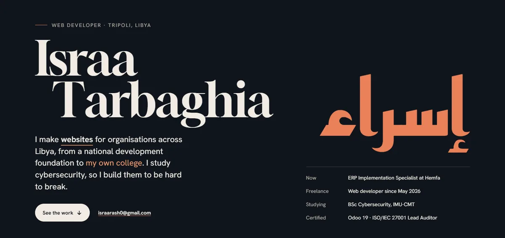

# Israa Tarbaghia

I design and build websites and web apps for organisations across Libya, from a national development foundation to my own college. I'm an ERP Implementation Specialist at Hemfa in Tripoli, I build websites as a freelancer, and I'm studying for a BSc in Cybersecurity at IMU-CMT.

**Portfolio:** [israairtirt.github.io](https://israairtirt.github.io/)

## Selected work

| Project | What it is |
|---|---|
| [Prospire Foundation](https://israairtirt.github.io/prospire-website/) | Website for a Libyan development foundation, with an interactive map of its national network and Ctrl+K search |
| [EJADA](https://israairtirt.github.io/ejada/) | Six-page site for an HR, training and recruitment consultancy in Tripoli and Cairo, with GSAP motion |
| [IMU-CMT College](https://israairtirt.github.io/imu-website/) | Website for IMU College of Management & Technology, opening on a three.js model of the campus |
| [Beati](https://beati.onrender.com/) | Environmental app for Libya: Flutter (Android, iOS, web), a Node.js API, PostgreSQL and an AI assistant |
| [PhishGuard](https://israairtirt.github.io/phishguard/) | Phishing-awareness training for small businesses, with red-flag feedback and a team dashboard |
| [Freelance Platform](https://israairtirt.github.io/freelance-platform/) | Marketplace where clients post projects and freelancers bid, hire and review |

Security case studies: [securing a housing association's tenant data](https://israairtirt.github.io/case-studies/housing-association.html) · [defending a travel agency's branch network](https://israairtirt.github.io/case-studies/travel-agency.html)

Source code is private.

## What I work with

- **Web and mobile:** HTML, CSS, JavaScript, React, TypeScript, Flutter, Node.js, Express, right-to-left layouts, GSAP, three.js
- **Back end and ERP:** Odoo 19 implementation, Python, PostgreSQL, SQLite, C# / .NET, Docker, Nginx
- **Security:** ISO/IEC 27001:2022 Lead Auditor, risk assessment, network design, secure coding

## Get in touch

[israarash0@gmail.com](mailto:israarash0@gmail.com) · [LinkedIn](https://www.linkedin.com/in/israa-tarbaghia) · Tripoli, Libya
